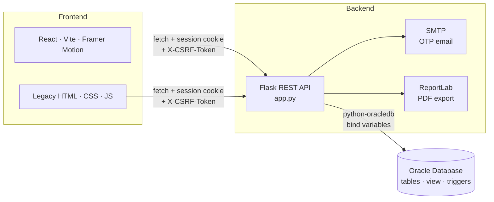
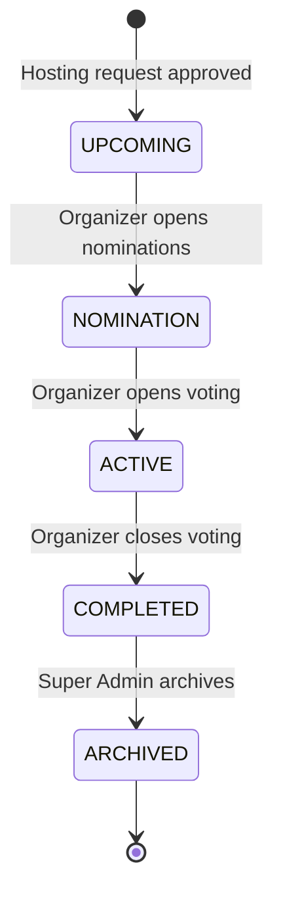
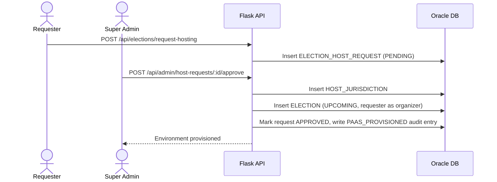
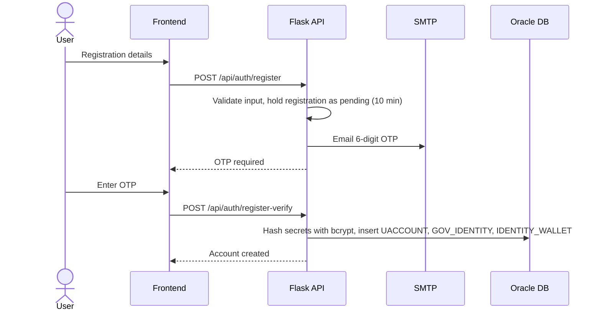
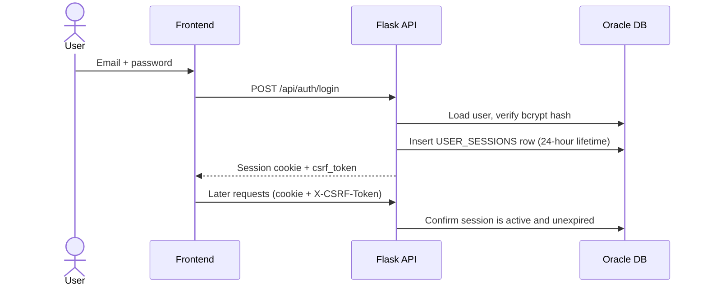
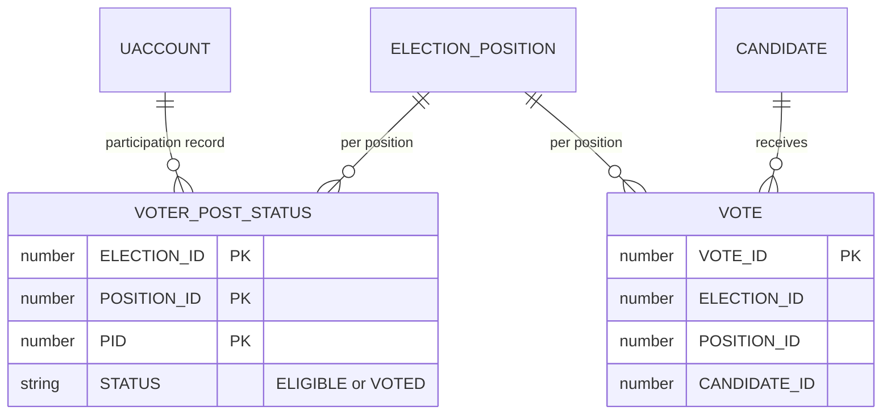

<div align="center">

# 🗳️ VoteCore V2

**A multi-tenant, phase-gated online voting platform with database-level election integrity**


[Overview](#-project-overview) •
[Features](#-core-features) •
[Architecture](#-architecture) •
[Installation](#-installation) •
[API](#-api-reference) •
[Database](#-database-schema) •
[Security](#-security-architecture) •
[Contributing](#-contributing)

</div>

---

## 📖 Project Overview

VoteCore V2 lets organizations run elections as a managed, multi-tenant service. An institution applies to host an election; a **Super Admin** approves the request, which provisions the election and appoints the requester as its **Election Organizer**. The organizer then runs the election day to day: defining ballot positions, scrutinizing parties and candidate tickets, whitelisting voters, and moving the election through its phases.

Integrity rules are enforced both in the Flask API and in Oracle itself (foreign keys, `CHECK` constraints, composite primary keys and triggers). Ballots are stored without any voter identifier, so a vote cannot be traced back to the person who cast it, while a separate ledger records *that* a voter has voted.

<!-- Add screenshots once available -->
<!--  -->

---

## ✨ Core Features

### 🏛️ Platform and tenancy
- **Hosting request workflow** — any registered user can apply to host an election for their institution (one pending request at a time). Super Admin approval creates the host jurisdiction and election and appoints the applicant as organizer, recording the provisioning in the audit log.
- **Direct election creation** — the Super Admin can also create an election directly. Organizers never create elections; they manage the ones they have been appointed to.
- **Phase-gated actions** — the backend only allows each action in the right phase: positions are defined during `UPCOMING`, parties can be formed or joined during `NOMINATION`, ballots are accepted only while `ACTIVE`, and results are released only when `COMPLETED`.

### 🔐 Identity and access
- **Email OTP registration** — new accounts are confirmed with a one-time code (valid for 10 minutes) before anything is written to the database.
- **Password recovery** — forgotten passwords are reset with an emailed OTP; a successful reset signs the user out of every active session and is written to the audit log.
- **Server-side sessions** — each login creates a row in `USER_SESSIONS` that is checked on every request, so sessions can be revoked ("log out of all devices").
- **Role-based access control** — Super Admin, Election Organizer, Party Leader, Candidate and Voter (see [RBAC Details](#-rbac-details)).
- **Neutrality enforcement** — database triggers stop an election's organizer from being a candidate, party leader or party member in the same election.

### 🎫 Nominations and campaigns
- **Party registration per election**, with the founder automatically nominated for President.
- **Party membership and ticket assignment** — leaders assign members to ballot positions with a manifesto.
- **Organizer scrutiny** — organizers approve or reject pending parties and candidates, and can withdraw approved candidates during `NOMINATION`.
- **Independent nominations** — eligible voters can nominate themselves for an open position without joining a party.
- **Candidate withdrawal** — candidates can withdraw their own approved nomination during `NOMINATION`.

### 🗳️ Voting
- **One vote per voter per position**, enforced by an atomic status update on `VOTER_POST_STATUS` (`ELIGIBLE` → `VOTED`).
- **Anonymous ballots** — the `VOTE` table holds election, position and candidate only.
- **Voter roll whitelisting** — voters apply per election and the organizer approves them.
- **Signed participation receipts** — an HMAC-signed receipt can be verified against a recorded ballot without revealing the voter's selection.
- **Live turnout analytics** — per-position progress compares the eligible voter roll with ballots cast and refreshes every 15 seconds.

### 📜 Accountability
- **Audit log** (`AUDIT_LOGS`) — administrative actions are written by the API and by database triggers on user and election changes.
- **Fraud log** (`FRAUD_LOGS`) — double-vote attempts (`DOUBLE_VOTE_ATTEMPT`) and ballots from unapproved voters (`UNAUTHORIZED_BALLOT`) are recorded by the API. It exposes no route that edits or deletes audit or fraud records.
- **PDF reports** — the Super Admin can export the fraud/security ledger; completed elections also publish an official results PDF with aggregate tallies and turnout.

### 🎨 Interface
- **React + Vite experience** — animated React routes, election cards and dialogs with Framer Motion, responsive layouts, and reduced-motion support.
- **Legacy static interface** — the existing HTML, CSS and JavaScript pages remain available during the migration.

---

## 🏗️ Architecture



The repository includes the existing static frontend and a React + Vite frontend in `frontend/react-app`. Both call the Flask API; Flask serves JSON and PDFs, not the frontend HTML. The static app remains available while the React migration is validated.

### Election lifecycle



| Phase | What is allowed |
|---|---|
| `UPCOMING` | Organizer defines ballot positions; voters can apply to the roll (applications stay open until the election is completed) |
| `NOMINATION` | Parties are registered and joined; tickets are assigned and scrutinized; independents are nominated; candidates can withdraw |
| `ACTIVE` | Whitelisted voters cast ballots |
| `COMPLETED` | Results are published and the official PDF can be exported |
| `ARCHIVED` | Election is hidden from public lists |

> The allowed phase values are enforced by a database `CHECK` constraint. The strict one-way order shown above is the intended flow; see [Known Limitations](#-known-limitations-and-roadmap).

### Hosting (PaaS) flow



### Registration flow



### Login flow



---

## 🛠️ Tech Stack

| Layer | Technology |
|---|---|
| Frontend (React) | React 19, Vite 7, React Router 7, Framer Motion |
| Frontend (legacy) | HTML, CSS, Vanilla JavaScript |
| Backend | Python **3.14**, Flask 3.1, Flask-CORS |
| Database | Oracle Database 21c XE |
| DB driver | `python-oracledb` (thin mode) |
| Authentication | Flask sessions, `bcrypt`, email OTP over SMTP (registration and password reset) |
| Document generation | ReportLab (results PDF and PDF audit ledger) |
| Configuration | `python-dotenv` |
| Tooling | `start-server.bat` (Windows launcher), `test_db.py`, `test_palette.ps1`, `test_landing_experience.ps1` |

Exact dependency versions are pinned in [`requirements.txt`](backend/requirements.txt) and [`package.json`](frontend/react-app/package.json).

---

## 🔒 Security Architecture

| Control | Implementation |
|---|---|
| **Password and ID hashing** | Passwords, voter ID (EPIC) and government ID numbers are hashed with `bcrypt` before storage. |
| **Password policy** | Minimum 8 characters with upper-case, lower-case, digit and special character. |
| **Email OTP verification** | Registration and password reset require an emailed 6-digit OTP that expires after 10 minutes. Recovery codes are checked against a bcrypt hash. |
| **Server-validated sessions** | Every protected request is checked against `USER_SESSIONS` (active and unexpired, 24-hour lifetime). Logging out, a password reset, or "log out all devices" deactivates the rows. |
| **CSRF protection** | A per-session token is issued at login and required in the `X-CSRF-Token` header for every `POST`, `PUT`, `PATCH` and `DELETE`. |
| **Cookie hardening** | Session cookie is `HttpOnly` and `SameSite=Lax`. |
| **SQL injection** | All queries use Oracle bind variables. |
| **Input validation** | Length-limited, trimmed text fields on write endpoints. |
| **CORS allowlist** | `127.0.0.1` / `localhost` on ports `5500` and `5501` (static frontend), plus `127.0.0.1:5173` (Vite). |
| **Ballot secrecy** | `VOTE` has no voter column; participation is tracked separately in `VOTER_POST_STATUS`. |
| **Double-vote prevention** | Atomic `UPDATE ... WHERE STATUS = 'ELIGIBLE'` backed by a composite primary key; failed attempts are written to `FRAUD_LOGS`. |
| **Signed receipts** | Participation receipts are HMAC-SHA256 signed with the server secret and carry no vote selection. |
| **Organizer neutrality** | Triggers `TRG_CAND_NEUTRALITY`, `TRG_EPARTY_NEUTRALITY` and `TRG_EPM_NEUTRALITY`; the API also blocks organizers and the Super Admin from registering, joining parties or voting. |
| **Secret management** | Credentials live in a local `.env` file excluded from version control. |

> **Note on secrecy:** anonymity comes from keeping ballots and participation records in separate tables with no shared key. It is not encryption. Anyone with direct database access can still compare timestamps, so database access should be tightly restricted.

---

## 🧑‍⚖️ RBAC Details

> **Elections are created by the Super Admin** — either directly or by approving a hosting request. **Organizers only organize and manage** elections that already exist.

| Role | How it is assigned | Responsibilities |
|---|---|---|
| **Super Admin** | Identified by an email check in `app.py` (see [Configuration](#-configuration)) — an application-level role, not stored in the database | Creates elections, approves or rejects hosting requests (which provisions elections and appoints organizers), archives elections, views global audit and fraud logs, exports PDF ledgers. Cannot vote or participate. |
| **Election Organizer** | Becomes `ELECTION.ORGANIZER_PID` when a hosting request is approved | Manages phases, defines ballot positions, approves voters, parties and tickets for their own election, and sees audit and fraud logs for it. Does not create elections. Cannot be a candidate, party leader or member, and cannot vote in it. |
| **Party Leader** | Registers a party for an election (`ELECTION_PARTY.CAMPAIGN_LEADER_PID`) | Views party members and assigns candidate tickets with manifestos. The party must be approved by the organizer. |
| **Candidate** | Assigned a ticket by a leader (or self-nominated as an independent) and approved by the organizer | Contests a specific ballot position. |
| **Voter** | Any registered user approved onto an election's voter roll | Casts one anonymous ballot per position. |

Apart from the Super Admin, roles are contextual: they are derived from the data (for example, who organizes *this* election) rather than stored in a role table.

---

## 📁 Project Structure

```text
VoteCore/
├── backend/
│   ├── app.py                  # Flask application and all REST API routes
│   ├── db.py                   # Oracle connection helper (used by test_db.py)
│   ├── schema.sql              # Tables, indexes, result view, triggers
│   ├── test_db.py              # Oracle connectivity check
│   ├── requirements.txt        # Pinned Python dependencies
│   ├── .env.example            # Environment variable template
│   ├── .env                    # Your local configuration (git-ignored)
│   └── start-server.bat        # Windows launcher (expects ./venv next to app.py)
├── frontend/
│   ├── index.html              # Login, OTP and registration
│   ├── register.html           # Legacy registration page
│   ├── dashboard.html          # Election list and hosting requests
│   ├── election.html           # Ballot, parties, voter registration
│   ├── results.html            # Election results
│   ├── profile.html            # Profile and session management
│   ├── admin.html              # Super Admin and Organizer panels
│   ├── script.js               # API client and page logic
│   ├── style.css               # Civic Ledger design system
│   ├── test_palette.ps1        # Style/markup contract check
│   ├── test_landing_experience.ps1  # Landing/auth page contract check
│   └── react-app/              # React + Vite frontend
│       ├── src/                # App.jsx, api.js, main.jsx, styles.css
│       ├── index.html
│       ├── package.json
│       └── vite.config.js
├── docs/
│   └── VoteCore_ER_Diagram.png # Entity-relationship diagram
├── output/erd/                 # Exported ER diagram files (PNG / SVG)
├── .vscode/                    # Live Server and debug settings
└── README.md
```

---

## 🚀 Installation

### Prerequisites

- Python **3.14**
- Oracle Database 21c XE, or access to another Oracle instance
- An SQL client that can run PL/SQL scripts (SQL*Plus, SQLcl or SQL Developer)
- An SMTP account for OTP emails (Gmail with an [App Password](https://support.google.com/accounts/answer/185833) works)
- Node.js 20.19+ or 22.12+ (only for the React frontend)
- Git

> `python-oracledb` runs in thin mode by default, so Oracle Instant Client is not required unless you opt in to thick mode in your own code.

### 1. Clone the repository

```bash
git clone https://github.com/VarunGupta2811/VoteCore.git
cd VoteCore
```

### 2. Set up the backend

```bash
cd backend
python -m venv venv
source venv/bin/activate        # Windows: venv\Scripts\activate
pip install -r requirements.txt
```

### 3. Create the database schema

Run the schema as the Oracle user that will own the tables. It contains triggers terminated with `/`, so use a client that understands PL/SQL scripts. The script creates objects without dropping existing ones, so use a fresh schema:

```bash
sqlplus [DB_USER]/[DB_PASSWORD]@[DB_DSN] @schema.sql
```

### 4. Configure environment variables

Create `backend/.env` from the template (see [Configuration](#-configuration) for every variable):

```bash
cp .env.example .env            # Windows: copy .env.example .env
```

### 5. Verify the database connection

```bash
python test_db.py
```

You should see `Oracle connection successful!` followed by the connected user.

### 6. Set the Super Admin

Change the email compared against in the `is_super_admin` check of the `login` handler in `app.py` to your own account, then register with that address. See [Configuration](#-configuration).

### 7. Start the API

```bash
python app.py
```

On Windows you can use `start-server.bat` instead. The API listens on `http://127.0.0.1:5000`.

### 8. Run a frontend

To run the React + Vite app, use Node.js 20.19+ or 22.12+:

```bash
cd frontend/react-app
npm ci
npm run dev
```

Open **http://127.0.0.1:5173** (use `127.0.0.1`, not `localhost` — the Vite origin allowed by the Flask CORS configuration is `127.0.0.1:5173`). To point the app to a different API origin, set `VITE_API_URL` before starting Vite.

The existing static frontend can still be served independently. In a second terminal, serve the `frontend/` folder from an origin the backend allows (`127.0.0.1` or `localhost`, port `5500` or `5501`):

```bash
cd frontend
python -m http.server 5500
```

Open **http://127.0.0.1:5500/index.html**. The VS Code Live Server extension works equally well (the repository is preconfigured for port `5501`).

---

## ⚙️ Configuration

### Environment variables (`backend/.env`)

| Variable | Required | Description |
|---|:---:|---|
| `DB_USER` | ✅ | Oracle username |
| `DB_PASSWORD` | ✅ | Oracle password |
| `DB_DSN` | ✅ | Oracle connect string / DSN, for example `localhost:1521/XEPDB1` |
| `FLASK_SECRET_KEY` | ✅ | Signs sessions and vote receipts. The app refuses to start without it. |
| `SMTP_EMAIL` | ✅ | Sender address for OTP emails |
| `SMTP_PASSWORD` | ✅ | SMTP password (Gmail: a Google App Password, not your account password) |
| `SMTP_SERVER` | ➖ | Defaults to `smtp.gmail.com` |
| `SMTP_PORT` | ➖ | Defaults to `587` |
| `SMTP_TIMEOUT` | ➖ | Present in the template; the current code uses a fixed 45-second timeout |
| `VOTECORE_PORT` | ➖ | API port, defaults to `5000` |
| `FLASK_DEBUG` | ➖ | Set to `1` to enable debug mode (development only) |

Generate a secret key:

```bash
python -c "import secrets; print(secrets.token_hex(32))"
```

Make sure secrets never reach version control:

```gitignore
.env
venv/
__pycache__/
```

### Code-level settings

| Setting | Where | Notes |
|---|---|---|
| Super Admin identity | `app.py`, `is_super_admin` check in the `login` handler | Currently a hard-coded email comparison. Change it to your own admin account before deploying. |
| API base URL (static UI) | `frontend/script.js`, `API_URL` | Defaults to `http://127.0.0.1:5000` |
| API base URL (React UI) | `VITE_API_URL` environment variable | Defaults to `http://127.0.0.1:5000` |
| Allowed origins | `app.py`, `CORS(...)` | Add your frontend origin when deploying |

---

## ▶️ Usage

### End-to-end walkthrough

1. **Register and sign in** on `index.html` (or the React app). Registration requires an emailed OTP; sign-in uses your email and password.
2. **Request hosting** — from the dashboard, a user submits an organization name, election title and description.
3. **Approve (Super Admin)** — in `admin.html`, review the application. Approval provisions the election in `UPCOMING` and makes the applicant its organizer.
4. **Configure (Organizer)** — add ballot positions (for example President, Secretary), then move the election to `NOMINATION`.
5. **Nominate** — participants register parties, members join, and party leaders assign candidate tickets. The organizer approves parties and tickets in the scrutiny panel.
6. **Whitelist voters** — voters apply from `election.html`; the organizer approves them.
7. **Vote** — the organizer moves the election to `ACTIVE`. Approved voters cast one ballot per position and receive a signed receipt.
8. **Publish results** — the organizer moves the election to `COMPLETED`; standings appear on `results.html` and the official PDF can be downloaded.
9. **Audit and archive** — the Super Admin reviews audit and fraud logs, exports the PDF ledger and archives the election.

### Calling the API directly

Protected routes need the session cookie. State-changing requests also need the CSRF token returned by `login` (or `GET /api/auth/me`).

```bash
# 1. Sign in: sets the session cookie, and the response includes "csrf_token"
curl -c cookies.txt -X POST http://127.0.0.1:5000/api/auth/login \
  -H "Content-Type: application/json" \
  -d '{"email": "[EMAIL]", "password": "[PASSWORD]"}'

# 2. Read elections
curl -b cookies.txt http://127.0.0.1:5000/api/elections

# 3. Cast a vote
curl -b cookies.txt -X POST http://127.0.0.1:5000/api/elections/[ELECTION_ID]/vote \
  -H "Content-Type: application/json" \
  -H "X-CSRF-Token: [CSRF_TOKEN]" \
  -d '{"candidate_id": [CANDIDATE_ID]}'
```

---

## 🔌 API Reference

Base URL: `http://127.0.0.1:5000`. All `/api/*` routes except the five public authentication routes (`register`, `register-verify`, `login`, `forgot-password`, `reset-password`) require an authenticated session. State-changing requests also require the `X-CSRF-Token` header.

### Authentication

| Method | Endpoint | Description |
|---|---|---|
| `POST` | `/api/auth/register` | Validate registration data and email an OTP |
| `POST` | `/api/auth/register-verify` | Confirm the OTP and create the account |
| `POST` | `/api/auth/login` | Verify password and start a session (returns `csrf_token`) |
| `POST` | `/api/auth/forgot-password` | Email a password-recovery OTP |
| `POST` | `/api/auth/reset-password` | Verify the recovery OTP and set a new password |
| `GET` | `/api/auth/me` | Session state, role flags and CSRF token |
| `GET` | `/api/auth/profile` | Profile and affiliations |
| `POST` | `/api/auth/logout` | End the current session |
| `POST` | `/api/auth/logout-all` | End all active sessions |

### Elections and participation

| Method | Endpoint | Description |
|---|---|---|
| `GET` | `/api/elections` | List elections |
| `GET` | `/api/elections/<id>` | Election details and the caller's voter status |
| `POST` | `/api/elections/request-hosting` | Submit a hosting request (`org_name`, `title`, `description`) |
| `POST` | `/api/elections/<id>/register-voter` | Apply to the voter roll |
| `GET` | `/api/elections/<id>/positions` | Ballot positions |
| `GET` | `/api/elections/<id>/parties` | Approved parties |
| `POST` | `/api/elections/<id>/register-party` | Register a party (`party_name`, `manifesto`) |
| `POST` | `/api/elections/<id>/parties/<party_id>/join` | Join a party |
| `GET` | `/api/elections/<id>/my-party-members` | Members of the caller's party |
| `POST` | `/api/elections/<id>/nominate-independent` | Self-nominate (`position_id`, `manifesto`) during `NOMINATION` |
| `POST` | `/api/elections/<id>/assign-candidate` | Leader assigns a ticket (`member_pid`, `position`, `manifesto`) |
| `GET` | `/api/elections/<id>/candidates` | Approved candidates |
| `POST` | `/api/elections/<id>/candidates/<candidate_id>/withdraw` | Candidate withdraws during `NOMINATION` |
| `POST` | `/api/elections/<id>/vote` | Cast a vote (`candidate_id`) |
| `GET` | `/api/elections/<id>/turnout` | Per-position voter-roll and ballot counts |
| `GET` | `/api/elections/<id>/receipt/verify?token=<receipt>` | Verify a signed participation receipt |
| `GET` | `/api/elections/<id>/results` | Results, only when `COMPLETED` |
| `GET` | `/api/elections/<id>/results/export` | Download the official results PDF, only when `COMPLETED` |

### Administration

| Method | Endpoint | Access | Description |
|---|---|---|---|
| `GET` | `/api/admin/host-requests` | Super Admin | List hosting applications |
| `POST` | `/api/admin/host-requests/<req_id>/approve` | Super Admin | Approve and provision |
| `POST` | `/api/admin/host-requests/<req_id>/reject` | Super Admin | Reject a hosting request |
| `POST` | `/api/admin/elections` | Super Admin | Create an election directly (`orgid`, `title`, `description`) |
| `DELETE` | `/api/admin/elections/<id>` | Super Admin | Archive an election |
| `GET` | `/api/admin/elections/<id>/export-fraud-log` | Super Admin | Download the PDF ledger |
| `GET` | `/api/admin/my-elections` | Organizer | Elections the caller organizes |
| `PUT` | `/api/admin/elections/<id>/status` | Organizer | Change phase (`status`) |
| `POST` | `/api/admin/elections/<id>/positions` | Organizer | Add a ballot position (`title`), during `UPCOMING` |
| `GET` | `/api/admin/elections/<id>/pending-voters` | Organizer | Pending voter applications |
| `POST` | `/api/admin/elections/<id>/approve-voter` | Organizer | Approve a voter (`pid`) |
| `POST` | `/api/admin/elections/<id>/reject-voter` | Organizer | Reject a voter-roll application (`pid`) |
| `GET` | `/api/admin/elections/<id>/pending-parties` | Organizer | Pending parties |
| `POST` | `/api/admin/parties/<party_id>/approve` | Organizer | Approve a party |
| `POST` | `/api/admin/parties/<party_id>/reject` | Organizer | Reject a party and its pending tickets |
| `GET` | `/api/admin/elections/<id>/pending-candidates` | Organizer | Review pending tickets and approved candidates |
| `POST` | `/api/admin/candidates/<candidate_id>/approve` | Organizer | Approve a ticket |
| `POST` | `/api/admin/candidates/<candidate_id>/status` | Organizer | Reject a pending candidate or withdraw an approved candidate during `NOMINATION` |
| `GET` | `/api/admin/audit-logs` | Super Admin / Organizer | Global logs for the admin, own logs for an organizer |
| `GET` | `/api/admin/fraud-logs` | Super Admin / Organizer | Fraud alerts |

---

## 🗄️ Database Schema

`backend/schema.sql` creates 18 tables, 8 indexes, one view and five triggers.


| Module | Tables |
|---|---|
| **Authentication and identity** | `UACCOUNT`, `GOV_IDENTITY`, `IDENTITY_WALLET`, `OTP_VERIFICATION`, `USER_SESSIONS` |
| **Platform provisioning** | `ELECTION_HOST_REQUEST`, `HOST_JURISDICTION`, `POLITICAL_PARTY` |
| **Core election** | `ELECTION`, `ELECTION_POSITION`, `EVENT_PARTICIPANTS` |
| **Nominations** | `ELECTION_PARTY`, `ELECTION_PARTY_MEMBER`, `CANDIDATE` |
| **Voting engine** | `VOTER_POST_STATUS`, `VOTE` |
| **Auditability** | `AUDIT_LOGS`, `FRAUD_LOGS` |

**View:** `V_ELECTION_RESULT_BY_POST` aggregates vote counts per candidate and position, labelling candidates without a party as `Independent`.

**Triggers:** three neutrality triggers (organizer cannot be a candidate, party leader or party member in their own election) and two audit triggers on `UACCOUNT` and `ELECTION`. Fraud records are written by the API, not by triggers.

Additional exports of the diagram are in `output/erd/`.

### How ballot secrecy is modelled



`VOTER_POST_STATUS` knows who voted for which position. `VOTE` knows which candidate received a ballot. Nothing links the two.

---

## 🧪 Testing

There is no automated API test suite yet. Three checks are included:

```bash
# Oracle connectivity (from backend/)
python test_db.py
```

```powershell
# Style and markup contracts (from frontend/, Windows PowerShell)
.\test_palette.ps1
.\test_landing_experience.ps1
```

`test_palette.ps1` asserts that the shared palette tokens, status pill colours and the hosting-request card styles are still present in `style.css`, `admin.html` and `script.js`. `test_landing_experience.ps1` checks that the login page keeps the DOM hooks and styles the auth flow depends on.

---

## 🧭 Known Limitations and Roadmap

- [ ] Enforce the one-way phase order in `PUT /api/admin/elections/<id>/status` (`ALLOWED_ELECTION_TRANSITIONS` is defined in `app.py` but not yet applied).
- [ ] Add login-attempt throttling (`MAX_LOGIN_ATTEMPTS`, `LOGIN_WINDOW_SECONDS` and `failed_login_attempts` are declared in `app.py` but not yet used by the login route), and OTP attempt limits.
- [ ] Optionally add an OTP second factor at login — OTP delivery already exists for registration and password recovery.
- [ ] Provide a way to appoint an organizer for elections the Super Admin creates directly via `POST /api/admin/elections`; today those elections are created without an organizer.
- [ ] Move pending registrations from process memory to a shared store, so restarts and multiple workers do not lose or split state.
- [ ] Stop writing the plaintext `OTP_CODE` for recovery codes (the bcrypt hash in `OTP_CODE_HASH` is sufficient).
- [ ] Replace the hard-coded Super Admin email with configuration or a database role.
- [ ] Run behind a production WSGI server with HTTPS and `SESSION_COOKIE_SECURE`.
- [ ] Add automated tests for the API and the voting flow.
- [ ] Remove or update the legacy `register.html`, which does not match the current registration API.

---

## 🤝 Contributing

Contributions are welcome.

1. Fork the repository.
2. Create a feature branch: `git checkout -b feature/your-feature`.
3. Make your changes. Keep schema changes in `backend/schema.sql` and document new endpoints in this README.
4. Run `python test_db.py` and the `.ps1` checks where relevant, and manually test the affected flows.
5. Commit: `git commit -m "Add your feature"`.
6. Push: `git push origin feature/your-feature`.
7. Open a Pull Request describing the change and how you tested it.

Please open an issue first for major changes so the approach can be discussed. Never commit `.env`, credentials or real voter data. Report security vulnerabilities privately to the contact below rather than in a public issue.

---

## 📄 License

`[LICENSE_TYPE]` — see the [LICENSE](LICENSE) file for details. Until a license file is added, all rights are reserved by default.

---

## 📬 Contact

**Varun Gupta** — [@VarunGupta2811](https://github.com/VarunGupta2811)